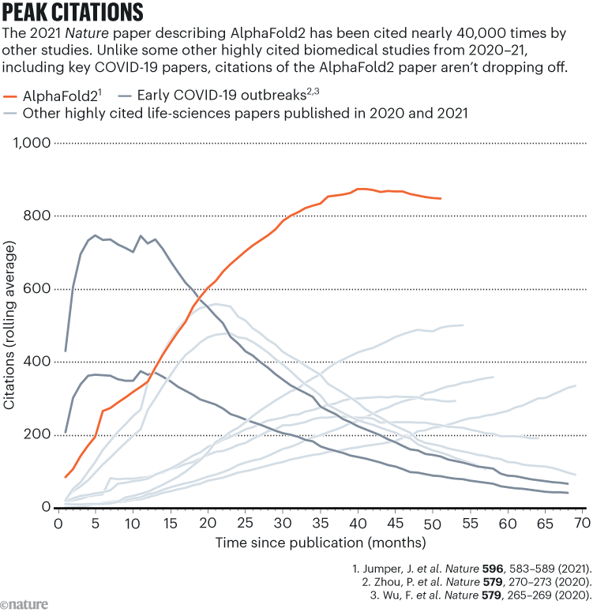
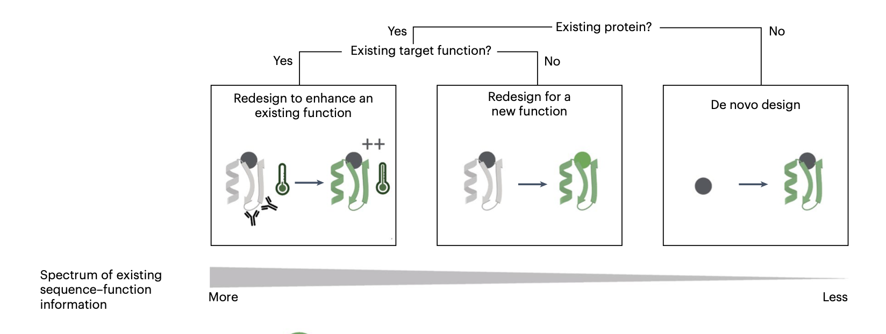



Artificial intelligence (AI). It’s everywhere. And biology is no exception. In lockstep with its growing popularity in technology, business, and general use, an increasing number of papers across a multitude of fields are filled with the promises that AI will transform biology (in fact, an entire recent issue of *Cell* is devoted to the topic [[1]](#ref1)).

In this part one of a two-part series on AI, we ask *what is newly and uniquely enabled by AI in biological research that was not possible before?* In doing so, we hope to also highlight some of the current limitations and opportunities for improvement. This is by no means exhaustive, but rather a set of illustrative vignettes highlighting different categories in which AI may be, and indeed is currently being, applied to biology. Specifically, we focus on how AI has been applied to computational and experimental biology research, excluding discussions of AI’s applications to medicine. What follows is a distillation based on our own reading of the literature and conversations with one another.

In part two, we speculate on what the future of science can look like in a world with AI.

Given how rapidly this field is evolving, some of the examples and facts in this series may be rapidly superseded by new developments, but we hope the principles of the discussions will still apply. We may update the series with new developments as the field progresses. 

We highlight below three application areas where AI has enabled new avenues of scientific research.

## [1] Prediction

Prediction, using a model to predict a property or result of interest, is perhaps the most developed application of AI in biology. AlphaFold [[2]](#ref2)[[3]](#ref3), RoseTTAFold [[4]](#ref4) and related models [[5]](#ref5) which predict protein structure from amino acid sequence, exemplified the power of AI to make high-fidelity predictions at scale. AlphaFold has been cited more than 40,000 times (**Figure 1**) and was the topic of part of the Nobel Prize in Chemistry in 2024.

{: width="526"}

**Figure 1:** Citations of the AlphaFold paper over time, in comparison to papers from the early COVID outbreak or other highly cited papers during the indicated time periods (from [[6]](#ref6)).

The principle of prediction has now been extended to many diverse areas. In gene regulation, increasingly sophisticated models (from early models, such as Basset [[7]](#ref7) to modern models such as BPNet [[8]](#ref8) and AlphaGenome [[9]](#ref9)) are able to predict features such as chromatin accessibility and transcription factor binding from DNA sequence alone. Models can predict more complex structures as well. For example, systematic mutagenesis data has enabled prediction of AAV viability and delivery properties and tropism [[10]](#ref10)[[11]](#ref11). A recent study used a model to diagnose different infectious and autoimmune diseases based on TCR and BCR repertoires from blood [[12]](#ref12). Even more ambitiously, recent ‘foundation’ models trained using vast numbers of publically available prokaryotic (Evo [[13]](#ref13)) and later bacterial, archaeal, eukaryotic, and bacteriophage (Evo2 [[14]](#ref14)) genomes can use input DNA sequence to predict features from all layers of the molecular dogma, from DNA to RNA to protein.

Why is good prediction helpful? Good predictors accelerate or narrow otherwise difficult experimental search spaces. For example, models trained on viral proteins preceding the COVID pandemic could predict the sequences most likely to escape immunity, later validated with experimental design of predicted antigenic variants [[15]](#ref15)[[16]](#ref16). This may inform pandemic response efforts before complete information is available. AI models traversed the massive antibiotic space to predict molecules most likely to kill bacteria of interest, enabling discovery of new classes of antibacterial compounds [[17]](#ref17)[[18]](#ref18), which would have been much more resource-intensive to test empirically.

In some cases, prediction is essential to make sense of noisy data. In super-resolution imaging, AI-based methods can improve image reconstruction [[19]](#ref19). In chemistry, DeepMet is a recently developed model which uses SMILES representations of known metabolites to predict plausible, previously unidentified metabolites, which authors used to successful identify several new metabolites from mass spectrometry data [[20]](#ref20).

Predictions are being used to enable mechanistic biological discovery as well. For example, in one application of AlphaFold, a recent paper has claimed to identify a new form of molecular “glue” that brings together two other molecules [[21]](#ref21). In brief, it was known that certain proteins and small molecules can serve to bring together pairs of proteins: for instance, PROTACs are large chimeric proteins that serve to bring an E3 ubiquitin ligase near a target molecule, co-opting cellular degradation machinery to degrade the target. This study showed for the first time that a metabolite, in particular a purine nucleotide, is able to act as a “glue” bringing the rate limiting enzyme for purine biosynthesis together with its inhibitor, explaining the mechanism of its feedback inhibition. AlphaFold appears to have been crucial to this discovery as it was able to model to a first approximation the presence of purine nucleotides in the binding pocket, setting up the hypothesis that the metabolite may potentially mediate this interaction. The vast majority of the paper is focused on carefully proving this interaction, including with crystallography, highlighting the importance of traditional techniques in today’s science to validate and verify predictions from even the most highly cited models. Predictions can enable downstream analyses and hypothesis generation.

Finally, a goal of prediction work is to not only learn the rules of existing data, but also predict response to a perturbation or change from baseline. This is based on the premise that models may be able to learn a causal model of the underlying biology. While still in their infancy, multiple recent models claim, for example, to be able to predict the effects and pathogenicity of DNA [[9]](#ref9) or protein variants [[22]](#ref22), with implications for interpretation of clinical sequencing data. While some early efforts at cell state predictions exist [[23]](#ref23), “Virtual Cell” initiatives aim to be able to predict the effects of any perturbation on overall cell state [[24]](#ref24)[[25]](#ref25). Although not yet at this level, the ability to use models to predict the effects of unseen perturbations is a holy grail that would allow models to serve as oracles that may be able to replace some experiments.

Overall, AI models have been able to leverage large datasets to enable increasingly accurate predictions, which can accelerate and bypass experimentation and enable new mechanistic discoveries.

## [2] Analysis

Analysis takes prediction one step further. Can we not only use a model to predict B from A, but use what the model has learned in the process (e.g. “look under the hood” of the model) to illuminate new biology? Such use of “interpretable models” has revealed surprising biology. For example, one genomics model trained to predict high-resolution transcription factor binding from DNA sequence discovered a periodic-mode of DNA-binding that would not have been discovered by traditional position-weight matrix binding motif models [[8]](#ref8). The authors made this discovery by analyzing model attributions (in simplified terms, what the model considers important to make the prediction) for the transcription factor’s binding pattern. Another paper used a similar model trained to predict chromatin accessibility to make progress on a long-standing puzzle for how a transcriptional regulator, *Aire*, selects its targets. *Aire* is key to immunologic tolerance, with a unique mechanism of action where it controls ectopic expression of gene expression programs from across the body within the thymus to “educate” developing T cells about what is “self” to prevent autoimmunity. By analyzing what the model had learned, the authors identified a surprising reliance on specific transcription factor binding sites and Z-DNA [[26]](#ref26) (DNA which turns in the opposite direction as usual). In the protein domain, another group of researchers showed the power of large-scale prediction by using the vast catalogue of protein structures predicted by AlphaFold to first organize viral proteins by structural similarity and then demonstrate certain structures resembling proteins from the eukaryotic cells they infect. In doing so, they used these structural similarities to identify new mechanisms of viral host evasion [[27]](#ref27) which coopted endogenous host cell machinery. The structural predictions from AI models implicitly encoded novel functions, which the researchers identified in their downstream analysis.

AI models have also made it possible to analyze new types of data. For example, in a recent paper, researchers trained a model to predict sudden cardiac death from ECGs. They analyzed the predictions and found a new ECG biomarker distinct from known patterns that was highly predictive of mortality [[28]](#ref28). This format of data was much more difficult to analyze at scale before (and relied more on manual feature engineering and extraction). In the imaging setting, AI analysis of image data has enabled quantitative analyses of the health consequences of the thymus [[29]](#ref29) for the first time.

Thus, as prediction becomes more accurate, analysis of what models have learned can enable new biological insights.

## [3] Design

Design sits at the frontier of AI applications in biology – can models be used not only for prediction but for the generation of new biomolecules, and by extension, of new biology?

Much as predecessors to AI models moved from prediction or classification (e.g. label an image as a cat) to generation (e.g. create an image of a cat), so the power of AI models for prediction has now also extended to generation of biology across scales and domains. Fittingly, alongside the AlphaFold prediction efforts above, David Baker won the Nobel Prize in Chemistry in 2024 for advances in computational protein design.

Extending the successes in protein structure prediction, design of proteins is one of the most advanced areas of AI-powered biomolecule design. As discussed in [[30]](#ref30), proteins can be designed with increasing levels of novelty, with varying reliance on existing proteins as starting points (see Figure 2). “Re-design” is a strategy that starts closest to existing protein structures. This approach redesigns existing proteins to enhance a function. For example, models have predicted which mutations will best enhance hydrolase activity [[31]](#ref31). A related design approach that takes proteins farther from their original contexts is re-designing a protein to give it a novel function. For example, one study shifted the targets that recombinases act on [[32]](#ref32). The first approach usually depends on good sequence to structure prediction or existing mutation-phenotype data that allows inference of the impact of changes to the enzyme. The latter can use datasets such as systematic protein mutagenesis (e.g. “deep mutational scans”) or observations of protein variation in nature within or across evolutionarily-distant organisms.

The most novel form of protein engineering is de novo design, design of new proteins without relying on an existing protein scaffold. This has been accomplished via numerous methods. Sequence-based generation models such as protein language models [[33]](#ref33)[[34]](#ref34)[[35]](#ref35) and DNA foundation language models [[13]](#ref13)[[14]](#ref14) are similar to LLMs, but operate on protein or DNA sequences instead of text inputs. Structure-based generation models such as inverse folding models [[36]](#ref36) operate in the opposite direction by predicting sequence from structure. In a different category, diffusion models [[37]](#ref37) generate protein structures from noise and hallucination methods [[38]](#ref38) start from random sequences that are iteratively optimized to a target structure (see [[30]](#ref30), [[39]](#ref39), [[40]](#ref40) for more detailed discussion).

**Figure 2:** Schematic of different types of protein design strategies, categorized by the degree of departure from existing protein structures (from [[30]](#ref30)).

Such advances have created bespoke proteins optimized to diverse functional applications. For example, de novo protein designs have generated novel artificial luciferases [[41]](#ref41), new inhibitors of clostridial toxins [[42]](#ref42), and proteins that neutralize lethal snake venom [[43]](#ref43), among many other examples. AI approaches have modeled CRISPR-Cas sequences to improve gene editing efficacy [[44]](#ref44) or even to generate new minimal RNA-guided nucleases not seen in nature [[45]](#ref45). Protein design has now been extended to even more complex examples, such as design of antibodies that bind a target of interest [[46]](#ref46)[[47]](#ref47)[[48]](#ref48), bypassing otherwise laborious and lengthy animal immunization or empiric library screening methods. Tools like BoltzGen [[49]](#ref49) and BindCraft [[50]](#ref50) make it routine to design a binder for any target of interest with ease. Protein design has matured to the point where, in a recent review, David Baker’s team writes: “...the main question in the protein binder design area is no longer how to design binders, but what to design binders to and for what application” [[40]](#ref40).

While not as advanced as protein applications, other areas of biology have also benefitted from AI-design methods. In genomics, this has included design of synthetic enhancers engineered to have cell-type specificity [[51]](#ref51) or RNA molecules with enhanced stability and translational capacity [[52]](#ref52). Genome “foundation” models like Evo and Evo2 have even been used to generate protein-DNA complexes or even entire genomes. More recently, this was extended to generate novel bacteriophages [[53]](#ref53)[[54]](#ref54), based on the classic ΦX174 phage. Some of the AI-generated synthetic phages had greater fitness than the original ΦX174 phage. In terms of cell engineering, while machine learning approaches have been used to optimize signaling for specific contexts, such as CAR-T cells [[55]](#ref55) or TF-guided induced pluripotent stem cell differentiation [[56]](#ref56), AI has not yet achieved de-novo computational cell engineering, given the complexity of prediction of cell states per above.

What does this enable? In a best case scenario, design opens up a whole new world of biology that is not constrained by the path taken by evolution. One could imagine creating bespoke molecules suited to any application. In experimental research, this could be useful for quickly designing molecules that modulate a pathway of interest. This could also create a new form of forward genetics. Instead of waiting to observe an association in nature, one could use a model to generate all possible versions of a molecule or pathway and test the outcome, building on current genetic approaches. Using models to arbitrarily generate any molecule which varies along an attribute of interest could enable quantitative and systematic principles of biology. In therapeutics, one could imagine generating new types of drugs engineered for maximum specificity and efficacy. Advances in AI molecular design could be combined with those in synthetic biology to create the components that make up new types of biological circuits.

AI-generated biological design has shown impressive results to alter existing biology or to create new biology. The ability to computationally generate molecules of interest has the potential to chart new avenues of biological research and therapeutic development.

## Limitations and gaps

Of course, like any method, AI-based approaches continue to have several limitations.

The main limitation for all models is data. What all successes share in common are large corpora of standardized and systematic data collection. Models are only as good as their training data and, while many models demonstrate good out- of- distribution prediction, missing classes of data are difficult to overcome. While databases like PDB and standardized testing such as the CASP project have powered much of the success in protein prediction and design, similar efforts are only just beginning in other areas. For example, there are now public challenges for AI-powered antibody design [[57]](#ref57) and for cell state prediction [[58]](#ref58).

However, not all data types are equally easy to collect or generate. For example, in the space of TCR-peptide-MHC interaction prediction, some sources estimate that the number of known, fully-specified TCR-antigen pairs numbers only in the hundreds [[59]](#ref59), due to difficulties in paired TCR sequencing and high-throughput TCR-antigen pairing assays.  Furthermore, much of biology is complex and context-dependent. There is often a tradeoff between the scale needed to gather enough data to train AI models and the fidelity of the collected data to human biology [[60]](#ref60). For example, prediction of genomic measurements in human cell lines which are easily generated may not necessarily represent the reality of primary cells in tissues. Some computational methods can overcome some of these challenges. As an illustration, transfer learning is an approach in which a model can learn generalizable principles or features from a large, diverse dataset and then can be fine tuned on a more specific area with smaller datasets. By building on what the model has already learned rather than starting from scratch, transfer learning can enable effective training even when relatively little task-specific data is available. Transfer learning has been applied to transcriptome prediction using diverse training data to make predictions for rare disease contexts [[61]](#ref61). However, ultimately, there is no substitute for true, experimental measurements, thus such approaches complement but do not replace advances in scalable, experimental data generation.

Moreover, another important conceptual drawback of current models is the inability to learn causal models of biology.  Most of the questions biologists are interested in are causal – if I change X, what will happen to Y? Most biological data at scale is instead observational and does not inherently represent causality. This is a general statistical problem, not unique to AI models (perhaps only exacerbated by the illusion that more data inherently leads to causal understanding). For example, LASSO regression, a classical technique which performs feature reduction, has in the past been used as a means to select the “most important features” in regressions. However, important features are not necessarily the causal ones [[62]](#ref62). This is being overcome by perturbations (whether from genetics or increasingly sophisticated experimental techniques) and causal inference modeling approaches. However, doing this in the right context for the right type of biological process, per above, remains a challenge.

Another major challenge for using models to learn new biology is interpretability. By default, most AI models are considered “black boxes,” in that how a model makes its prediction is not immediately clear. Knowing what a model uses for prediction is important for ensuring it is not learning artifactual features. In one instance, a model trained to predict pneumonias from chest x-rays picked up hospital-specific differences in image processing or scanner properties instead of the image characteristics themselves [[63]](#ref63). This poses a challenge if the goal is to analyze AI models for biological discovery. There are suites of interpretation techniques now being developed to interrogate what models have learned [[64]](#ref64). This can take the form of analyzing intermediate layers of models to understand how predictions are made or systematically removing parts of the model to understand what each piece recognizes. However, these approaches are far from trivial and are an active area of research in their own right. A related point worth bearing in mind is that more complex models are not necessarily better. Simpler models can often outperform complex machine learning models [[65]](#ref65), while retaining more interpretability. Indeed, some authors have used simpler models to interpret features from more complex one (e.g. a sparse autoencoder trained to extract features from Evo2 [[14]](#ref14)). A recent paper (“weight space programming”) claims that LLMs can be used to directly read and write model weights which may open up new ways of LLMs for model interpretation [[66]](#ref66).

LLM-based approaches will create new challenges in interpretability, especially in evaluating generalizability. Whereas an issue with the the chest xray example above could be identified by observed worse performance on unseen data, there will be fewer and fewer data sources that LLMs will not have already seen. Thus, as models learn from many different available datasets, data leakage across training and testing will become a more difficult issue. Many have already started to use proprietary datasets for model evaluation [[67]](#ref67). Indeed, with progression of models’ capabilities, a new field of interpretability called “mechanistic interpretability" has also emerged, moving from understanding the basis of any given prediction to asking how models solve a given class of problems [[68]](#ref68) by identifying higher-level structures within model weights.

Limitations in design echo the limitations in prediction. Molecules that are difficult to predict or model are also difficult to design. For example, in protein design, intrinsically disordered regions (IDRs) are notoriously difficult to predict and design due to their lack of defined structure [[69]](#ref69). Unlike proteins, as discussed above, many types of molecules cannot yet be predicted accurately by existing models, meaning design applications for these areas also naturally lag. Moreover, while models can generate a structure or optimize a particular property, structure may not always encode function (especially when dynamic processes are involved) and other properties not captured by the model, such as immunogenicity or target specificity, may be more relevant to *in vivo* function. Whereas this would have been previously solved by explicitly modeling each property individually, early results from AI genome-design approaches, such as in the phage example above, suggest that AI models may be able to learn more general fitness functions that simultaneously optimize multiple properties [[53]](#ref53). However, this will still require explicitly testing multiple properties of output molecules and assessing model capabilities in increasingly complex, multi-objective domains. Experimental generation will be a bottleneck for design as it is for prediction, both for data to train better predictors per above but also to synthesize model-designed molecules at sufficient scale to assay each property of interest. Efforts to improve experimental generation could create an optimal loop where design, prediction, and experimentation feed back onto one another to adaptively and iteratively improve output molecules.

Finally, a growing concern with design models is safety. As the capabilities of models to generate biologically active molecules grow, so does the concern for their misuse by bad actors. This has already led biodesign researchers to begin developing consensus statements regarding responsible use [[70]](#ref70) and lay out the landscape of possible threats [[71]](#ref71).  While there have been some government efforts to screen sequences for safety, and AI labs have begun to test biosecurity threats with model guardrails, there has not been large-scale consensus or action. Researchers training biological models have pre-emptively excluded viral sequences with the potential to infect eukaryotic hosts [[5]](#ref5)[[14]](#ref14) from their training data. Currently, the bottleneck is likely still experimental - testing newly designed sequences from fine-tuned models remains a resource-intensive endeavor. However, researchers working in the field recommend a multi-modal approach that includes filtering training sequences, screening and tracking sequences submitted for synthesis, regulatory governance, ‘red-teaming’ to test the limits of current capabilities, and method development to anticipate potentially dangerous design [[71]](#ref71). Safety will continue to be an active and important area to follow, with implications for the future of open-source biology research.

## Conclusion

Overall, AI models have unlocked new avenues in biological research, bypassed entire experimental workflows with accurate prediction, extracted new insights from complex data, and designed bioactive molecules never seen in nature. While many limitations remain, the question will not be if AI will be applied to biology but how it will be best used to contribute to the next set of advances. We believe a starting point of knowledge of where AI succeeds and fails can help clarify where it may be the most useful.

*Special thanks to Kevin Procopio for feedback.*

## References

    
Cell. Artificial intelligence special issue. Cell (2025). https://www.cell.com/cell/issue?pii=S0092-8674(25)X0020-9

    
Jumper, J. et al. Highly accurate protein structure prediction with AlphaFold. Nature 596, 583–589 (2021).

    
Abramson, J. et al. Accurate structure prediction of biomolecular interactions with AlphaFold 3. Nature 630, 493–500 (2024).

    
Baek, M. et al. Accurate prediction of protein structures and interactions using a three-track neural network. Science 373, 871–876 (2021).

    
Hayes, T. et al. Simulating 500 million years of evolution with a language model. Science 387, 850–858 (2025).

    
Callaway, E. AlphaFold is five years old — these charts show how it revolutionized science. Nature 648, 258–259 (2025).

    
Kelley, D. R., Snoek, J. & Rinn, J. L. Basset: learning the regulatory code of the accessible genome with deep convolutional neural networks. Genome Res. 26, 990–999 (2016).

    
Avsec, Ž. et al. Base-resolution models of transcription-factor binding reveal soft motif syntax. Nat. Genet. 53, 354–366 (2021).

    
Avsec, Ž. et al. Advancing regulatory variant effect prediction with AlphaGenome. Nature 649, 1206–1218 (2026).

    
Ogden, P. J. et al. Comprehensive AAV capsid fitness landscape reveals a viral gene and enables machine-guided design. Science 366, 1139–1143 (2019).

    
Bryant, D. H. et al. Deep diversification of an AAV capsid protein by machine learning. Nat. Biotechnol. 39, 691–696 (2021).

    
Zaslavsky, M. E. et al. Disease diagnostics using machine learning of B cell and T cell receptor sequences. Science 387, eadp2407 (2025).

    
Nguyen, E. et al. Sequence modeling and design from molecular to genome scale with Evo. Science 386, eado9336 (2024).

    
Brixi, G. et al. Genome modelling and design across all domains of life with Evo 2. Nature 652, 1349–1361 (2026).

    
Thadani, N. N. et al. Learning from prepandemic data to forecast viral escape. Nature 622, 818–825 (2023).

    
Youssef, N. et al. Computationally designed proteins mimic antibody immune evasion in viral evolution. Immunity 58, 1411–1421.e6 (2025).

    
Wong, F. et al. Discovery of a structural class of antibiotics with explainable deep learning. Nature 626, 177–185 (2024).

    
Stokes, J. M. et al. A deep learning approach to antibiotic discovery. Cell 180, 688–702.e13 (2020).

    
Li, S. et al. AI-empowered super-resolution microscopy: a revolution in nanoscale cellular imaging. Nat. Methods 23, 1746–1768 (2026).

    
Qiang, H. et al. Language model-guided anticipation and discovery of mammalian metabolites. Nature 651, 211–220 (2026).

    
Witus, S. R. et al. Metabolite glues as a means of purine sensing and chemotherapeutic response. Nature 655, 1300–1308 (2026).

    
Cheng, J. et al. Accurate proteome-wide missense variant effect prediction with AlphaMissense. Science 381, eadg7492 (2023).

    
Kamimoto, K. et al. Dissecting cell identity via network inference and in silico gene perturbation. Nature 614, 742–751 (2023).

    
Bunne, C. et al. How to build the virtual cell with artificial intelligence: priorities and opportunities. Cell 187, 7045–7063 (2024).

    
Eisenstein, M. ‘Virtual cells’ aim to turn raw data into predictive models of biology. Nature 654, 286–288 (2026).

    
Fang, Y. et al. AIRE relies on Z-DNA to flag gene targets for thymic T cell tolerization. Nature 628, 400–407 (2024).

    
Nomburg, J. et al. Birth of protein folds and functions in the virome. Nature 633, 710–717 (2024).

    
Obermeyer, Z. et al. An ECG biomarker for sudden cardiac death discovered with deep learning. Nature 655, 210–218 (2026).

    
Bernatz, S. et al. Thymic health consequences in adults. Nature 652, 986–994 (2026).

    
Notin, P. et al. Machine learning for functional protein design. Nat. Biotechnol. 42, 216–228 (2024).

    
Lu, H. et al. Machine learning-aided engineering of hydrolases for PET depolymerization. Nature 604, 662–667 (2022).

    
Schmitt, L. T. et al. Prediction of designer-recombinases for DNA editing with generative deep learning. Nat. Commun. 13, 7966 (2022).

    
Nijkamp, E., Ruffolo, J. A., Weinstein, E. N., Naik, N. & Madani, A. ProGen2: exploring the boundaries of protein language models. Cell Syst. 14, 968–978.e3 (2023).

    
Madani, A. et al. Large language models generate functional protein sequences across diverse families. Nat. Biotechnol. 41, 1099–1106 (2023).

    
Ferruz, N., Schmidt, S. & Höcker, B. ProtGPT2 is a deep unsupervised language model for protein design. Nat. Commun. 13, 4348 (2022).

    
Dauparas, J. et al. Robust deep learning-based protein sequence design using ProteinMPNN. Science 378, 49–56 (2022).

    
Watson, J. L. et al. De novo design of protein structure and function with RFdiffusion. Nature 620, 1089–1100 (2023).

    
Anishchenko, I. et al. De novo protein design by deep network hallucination. Nature 600, 547–552 (2021).

    
Winnifrith, A., Outeiral, C. & Hie, B. L. Generative artificial intelligence for de novo protein design. Curr. Opin. Struct. Biol. 86, 102794 (2024).

    
Yang, W. et al. The past, present and future of de novo protein design. Nature 652, 1139–1152 (2026).

    
Yeh, A. H.-W. et al. De novo design of luciferases using deep learning. Nature 614, 774–780 (2023).

    
Ragotte, R. J. et al. De novo design of potent inhibitors of clostridial family toxins. Proc. Natl Acad. Sci. USA 122, e2509329122 (2025).

    
Vázquez Torres, S. et al. De novo designed proteins neutralize lethal snake venom toxins. Nature 639, 225–231 (2025).

    
Ruffolo, J. A. et al. Design of highly functional genome editors by modelling CRISPR–Cas sequences. Nature 645, 518–525 (2025).

    
Skopintsev, P. et al. Structure and evolution-guided design of minimal RNA-guided nucleases. Science 393, 313–318 (2026).

    
Bennett, N. R. et al. Atomically accurate de novo design of antibodies with RFdiffusion. Nature 649, 183–193 (2026).

    
Mille-Fragoso, L. S. et al. Efficient generation of epitope-targeted antibodies with Germinal. Nat. Biotechnol. (2026).

    
Erasmus, M. F. et al. A blinded, prospective benchmark of in silico antibody discovery anchored to experimental affinity and developability. Nat. Biotechnol. (2026).

    
Stark, H. et al. BoltzGen: toward universal binder design. Preprint at bioRxiv https://doi.org/10.1101/2025.11.20.689494 (2025).

    
Pacesa, M. et al. One-shot design of functional protein binders with BindCraft. Nature 646, 483–492 (2025).

    
Taskiran, I. I. et al. Cell-type-directed design of synthetic enhancers. Nature 626, 212–220 (2024).

    
Zhang, H. et al. Deep generative models design mRNA sequences with enhanced translational capacity and stability. Science 390, eadr8470 (2025).

    
King, S. H. et al. Generative design of bacteriophages with genome language models. Science 393, eaec2657 (2026).

    
McCarty, N. AI-Designed Phages. Asimov Press (2025). https://www.asimov.press/p/ai-phages

    
Daniels, K. G. et al. Decoding CAR T cell phenotype using combinatorial signaling motif libraries and machine learning. Science 378, 1194–1200 (2022).

    
Appleton, E. et al. Machine-guided cell-fate engineering. Cell Rep. 44, 115726 (2025).

    
AIntibody. The AIntibody Challenges. https://www.aintibody.org/the-challenges/ (accessed 14 Nov. 2026).

    
Arc Institute. Virtual Cell Challenge. https://virtualcellchallenge.org/ (2026).

    
Hudson, D. et al. Can we predict T cell specificity with digital biology and machine learning? Nat. Rev. Immunol. 23, 511–521 (2023).

    
Fischer, D. S., Villanueva, M. A., Winter, P. S. & Shalek, A. K. Adapting systems biology to address the complexity of human disease in the single-cell era. Nat. Rev. Genet. 26, 514–531 (2025).

    
Theodoris, C. V. et al. Transfer learning enables predictions in network biology. Nature 618, 616–624 (2023).

    
Su, W., Bogdan, M. & Candès, E. False discoveries occur early on the Lasso path. Ann. Stat. 45, 2133–2150 (2017).

    
Zech, J. R. et al. Variable generalization performance of a deep learning model to detect pneumonia in chest radiographs: a cross-sectional study. PLoS Med. 15, e1002683 (2018).

    
Novakovsky, G. et al. Obtaining genetics insights from deep learning via explainable artificial intelligence. Nat. Rev. Genet. 24, 125–137 (2023).

    
Khoo, L. M. S. & Barzilay, R. Why machine learning fails at mass spectrometry for small molecules. Nat. Metab. 8, 1247–1249 (2026).

    
Takehi, R., Teoh, J., Zhang, A. & Khattab, O. Sparks of Weight-Space Programming: LLMs can natively read & write neural network weights. https://rikiyat.github.io/blog/weight-space-programming/ (2026).

    
Anthropic. Claude Opus 5.5 System Card (Anthropic, 2026). https://www.anthropic.com/claude-opus-5-5-system-card

    
Sharkey, L. et al. Open Problems in Mechanistic Interpretability. Preprint at arXiv https://arxiv.org/abs/2501.16496 (2025).

    
Wu, K. et al. Design of intrinsically disordered region binding proteins. Science 389, eadr8063 (2025).

    
Carter, S. R. et al. Community values, guiding principles, and commitments for the responsible development of AI for protein design (2024). https://responsiblebiodesign.ai/

    
Zhang, Z. et al. Generative AI for Biosciences: Emerging Threats and Roadmap to Biosecurity. Preprint at arXiv https://arxiv.org/abs/2510.15975 (2025).

