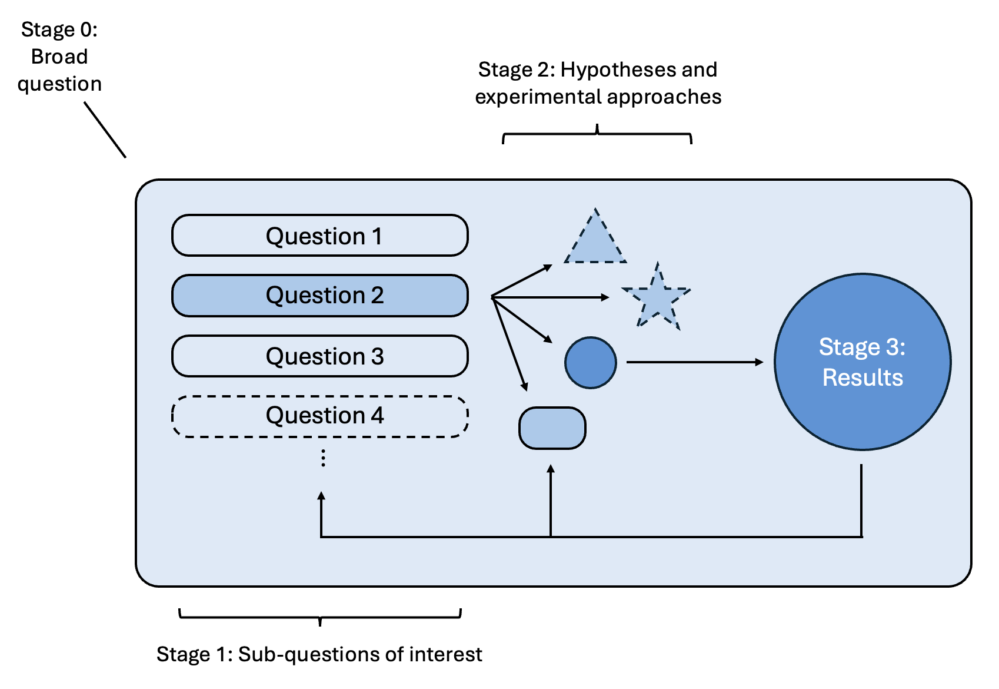
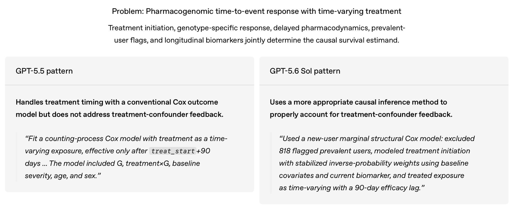



# Do we need humans at all?

{: width="600"}
*The classic diagram proposing Copernican heliocentrism (De revolutionibus orbium coelestium, 1543).*

Over the past few years, much of our casual conversations with peers has turned to the latest development in LLMs and their deployment[^fn1]. For all but those who are the most intimately involved in the industry, the rate of advancement in the field has been staggering and difficult to follow; just last year we were intermittently using frontier LLMs as a fancy StackExchange, whereas now entire side-projects can be vibe-coded without writing a single line of code.

Turning to biomedical research, we distinctly remember hearing from near-peers ahead of us on the MD-PhD training path telling us that our fields will likely transform while we are "away from the lab" in the period between our return to the clinic post-PhD and the end of our clinical training[^fn2]. For those who had completed their PhDs in molecular biology in the early 2010s, they returned, after clinical training, to a scientific world transformed by CRISPR. Many had spent huge amounts of time learning intricate protein engineering techniques[^fn3] for knocking out genes in cell lines, or resorted to powerful yet imperfect techniques such as interfering RNAs. CRISPR made it shockingly easy to generate entire libraries of total knock-outs, leading to the rise of the genome-wide CRISPR screen [[1]](#ref1)[[2]](#ref2), changing how many ask scientific questions. We completed our PhDs in 2022-2024 -- what was going to be our version of this? It seems likely that it is the use of modern AI in the scientific pipeline.

There have been many comparisons of modern AI to periods of sea change in technology, such as the industrial revolution [[3]](#ref3); others, however, have pointed to how despite the billions in AI investment, there has been little change to many day-to-day realities for many in the economy. Despite the fact that advances in AI are extensively discussed in our media environment, many colleagues involved in cutting-edge research have sworn off AI as a novelty unlikely to be substantially useful in research, highlighting limitations such as hallucinations.

Is this a paradox? Famously, Solow’s paradox ("You can see the computer age everywhere but in the productivity statistics."), based on an aphorism by Robert Solow, reflected a similar notion that digital computing had a strong pitch but lagged in its economic impact. In retrospect, there were several explanations for Solow’s paradox [[4]](#ref4) which we will refrain from comprehensively summarizing here. However, one of the most notable explanations was that it took ~decades to reshuffle workflows, enterprises, and organizational structures around digital computing. Today, we could not imagine a professional world without digital tools. It is likely that a similar lag will apply to the impact of AI in the scientific enterprise [[5]](#ref5).

In [our previous post](https://emergentpropertiesblog.com/2026/11/22/bio-age-of-ai-part-1/), we analyzed the use of AI-based tools for novel predictions, new analytical paradigms, or molecular design to imagine how this technology can slot into today’s science. Here we want to discuss a different question – how may we re-imagine the scientific enterprise around AI tools?

Different fields have to date been differentially impacted. In mathematics, where the language Lean can be used to rigorously and autonomously check mathematical proofs and close the loop between proposed solutions and subsequent validation, AI systems have generated proofs for several important open problems including several open problems collated from review of Erdős’s works [[6]](#ref6)[[7]](#ref7), a solution to the Navier Stokes existence and smoothness problem [[8]](#ref8) (albeit with controversy [[9]](#ref9)), and recently a staggering "drop" of solutions to hundreds more [[10]](#ref10). Very recently, Levent Alpöge from Anthropic released a proposed proof of the Riemann hypothesis [[11]](#ref11), a centuries old problem that many have felt was far from being solved by humans [[12]](#ref12). The validity and implications of this proof are, of course, still under evaluation. If it holds, the achievement implies the ability of AI models to use existing mathematical principles in ways never done before, or even to discover new mathematics. In machine learning research, AI Scientist by Sakana AI [[13]](#ref13) claims to be able to end-to-end automate ML research including with finished drafts of papers which have been accepted to AI conferences (whose submission volumes have been soaring, likely driven by autonomously generated manuscripts).

In biology, currently, the prevailing approach is the "AI co-scientist". Examples include Google Co-Scientist [[14]](#ref14), Seqera Co-Scientist, offerings by FutureHouse and Edison Scientific [[15]](#ref15), and others. Broadly, these approaches as they exist today use multi-agent LLM-based systems to review literature, generate hypotheses, rank hypotheses, and refine them. Some of these tools are able to run computational experiments when possible. In biology, most of these public facing tools seek to identify interesting new hypotheses or experimental plans for a question of interest.

As we write this post, this space is moving forward extremely rapidly. For instance, Anthropic has launched an experimental biology group that attempts to use Claude as a central component of the scientific workflow [[16]](#ref16) and has just claimed to identify a novel reverse transcriptase system through agent-driven analysis of ~11 million genomes and metagenomes using profile HMMs derived from known reverse transcriptases – though importantly this is still awaiting characterization and validation [[17]](#ref17).

To understand how these tools could be implemented in practice, we first touch upon the goals of science and the scientific researcher before speculating on ways by which current iterations of this technology could be used effectively in the way science is done. For people interested in this topic, we would recommend reading Terence Tao’s recent reflections on the field of mathematics in the age of AI as it has many parallels with our discussion below [[18]](#ref18).

We understand the specifics discussed here may be outdated in a matter of months[^fn4]. Regardless, it is useful to consider how today’s systems could be incorporated into today’s science as it can inform how the practice of science may evolve. We attempt to focus on principles that we hope will be broadly useful into the future.

## 1. What is the goal of the scientific enterprise and how is this achieved?

The modern basic scientific enterprise serves fundamentally to generate knowledge about the world. Indeed, the word draws its roots from the Latin verb *scire*, meaning "to know". This knowledge takes the shape of empirical data which can be used to propose theories about the world, or new methods to analyze or generate novel data which in turn can also be used to propose theories about the world. Many great philosophers have discussed the philosophy of science: Karl Popper, for instance, established the principle of falsifiability as a requirement for a scientific theory, namely that scientific theories cannot be directly proven true, and must allow for future evidence that proves them false [[19]](#ref19). Eventually, theories and insights generated by the scientific enterprise may result in applications which can tangibly impact our lives.

We contrast the term "basic science", which we use throughout this essay, with the field of translational research. Translational work attempts to focus on questions whose answers may be more directly applicable to the "real world", while basic research is focused on understanding a phenomenon and has the potential to impact the world in ways that are yet unanticipated. For instance, a study focused on the mechanism by which lipids are shuttled between two membranes of a cell is more basic, while a study focused on screening a new class of molecules to treat pancreatic cancer in mouse models is more translational.

To illustrate a common approach for scientific inquiry in biology, scientists with extensive subject area knowledge often start by formulating a question of interest within their field. They then obtain funding and resources to allow for investigation, with the grant application process often having a clarifying effect on the question at hand and/or plan of investigation. Scientists then perform experiments and/or analyses to address the question of interest. In the process, alternative interesting ideas and hypotheses often arise, and the final outcome of the research endeavor often looks very different from the original planned investigation. Several new questions of interest are often generated which sets up future projects.

## 2. How could AI be used throughout the scientific workflow?

Now, we briefly revisit the outline of the process of science and ask how LLMs can help at each stage.

### a. Finding a worthy question

The first step is to identify a question of interest. This is philosophically one of the most important parts of the scientific process.

Questions often arise from the results of a previous project, for instance a direction that was not explored or an anomaly that was not explained. The idea may be inspired by a seminar, where the scientist’s expertise allows them to see an opening others may not see or be interested in pursuing. The question may arise in the clinic, where a patient encounter reveals a knowledge gap important for understanding and treating a disease process relevant to them and others like them. The process of finding a question of interest is one that is usually running constantly in the background, integrating chance encounters with the scientist’s expertise and area of interest.

Questions are often nested. The question to answer with an experimental investigation may be far narrower than what we call the "broad question" -- for instance, one may be interested in the broad question "what causes ALS?" but instead choose to study "what is the mechanism by which unfolded proteins produce toxicity in a specific model of ALS?". In some sense, the decision of what broad question to study is inherently human -- sure, one could ask an AI model "find me interesting open questions in biology", but most people have at least some sense of an area of interest or expertise already developed. We believe at the broadest level, the area of interest should arise from the investigator -- however subsequent iterations and brainstorming around narrower questions could certainly be aided by AI models.

Agentic LLM systems are certainly good at *doing* things, but are they good at coming up with interesting questions? Just because a question is tractable and unanswered does not mean that the question is worth studying. This is the principle of "taste". When brainstorming with AI systems, they tend to produce numerous plausible seeming ideas and hypotheses, and often only a small percentage of these are interesting. This is a recognized concern, and is even mentioned in the Anthropic press release for their recent genomic analysis:

> *"**Because Claude produces hypotheses so prolifically, the hypotheses themselves have become an object of study for us.** With hundreds to thousands of candidate reports from a single campaign, we have been asking what distinguishes the proposals we judge worth testing from those we set aside. **What we learn goes back into the instructions we give Claude and teaches it to mimic our own scientific taste.**"*

Some scientists are able to integrate their expertise with the gaps in the field to pose and frame questions which have a relatively high potential for impactful results. This appears to be an *intuition*; as [we discussed previously](https://emergentpropertiesblog.com/2025/09/25/expertise-and-learning/), this is a type of System 1 thinking that comes from vast amounts of experience and exposure in a field. Taste is a sort of "special sauce" that arises from experience and defines expert scientists.

We define scientific taste as the ability to pose scientific questions that are both answerable and have the potential to address significant, high impact gaps in a field. In other words, to have taste is to identify *and* answer questions that are valuable to others either now or in the future. Taste is hard to develop and often is learned by training with people who have good taste.

LLMs do not currently demonstrate good taste. They currently generate a vast number of ideas that are often "not interesting", leaving the onus on the researcher to pick an idea to proceed with a line of investigation based on their own expert intuition. Of course this could improve; indeed there has been ample research on recommendation engines both using LLMs and in the pre-LLM era, indicating that automated systems can attempt to optimize for "taste". However, the path to training expert level taste at scale remains difficult to operationalize, and is not well suited for reinforcement learning techniques that have provided huge gains in other domains.

So what is the best way to use AI systems in the question generation stage? On one end lies the proposal of the broad question, which comes from the scientist. On the other end, Co-scientist and other methods are effective at *executing*, for instance in performing literature reviews and proposing experimental plans or models to test. In between these two is a process of narrowing and tweaking the question based on prior experience, interest, available resources, and taste. We suspect that at this middle stage, LLMs may be a helpful brainstorming partner. However, in their current form we caution that we should not allow LLMs to override "taste" but instead should be used as a way to **augment** the space of ideas upon which one can wield their scientific judgment. LLMs contain vast quantities of information across all corners of human knowledge, giving these tools the ability to integrate disparate fields in a way that is notoriously difficult for humans who specialize often in specific areas of knowledge. Indeed, much innovation has arisen from scientists bringing knowledge from one field to another. The generation of novel and interesting new interdisciplinary hypotheses with LLM assistance is a unique opportunity, and may be able to help scientists digest the ever expanding deluge of new literature being generated daily.

*Figure 1: Highly simplified schematic of the scientific idea generation process. Darker colors represent a selected approach. Dotted lines represent AI-generated paths.*

We attempt to schematize this in Figure 1 – AI models may help to formulate tweaked sub-questions of interest which could provide inspiration to the scientist. Similarly, models could aid in basic hypothesis and approach generation via automated literature review, potentially extending the researcher’s scope by reviewing papers from outside their field and immediate body of knowledge. Eventually however the selection of a question relies on taste. The whole process is cyclic, and both the question and approach may be tweaked based on results.

As a case study, a recent feature in Nature described the process by which a group at the Whitehead Institute used Google’s Co-scientist to aid in ideating novel approaches to target the oncogene Myc [[20]](#ref20). As they describe it:

> *"Getting to an idea worth pursuing took some work. Pertl and Whitehead bioengineer Kalon Overholt spent close to an hour going back and forth with Co-Scientist before it understood the question. At first, the AI model assumed that the protein clusters at the centre of the research were meant to be the drug rather than the target. The tool also assumed that the clusters always activated gene expression, when in fact some do the opposite. Once Pertl and Overholt had corrected these misconceptions, they set the system loose. By the next day, Co-Scientist had combed through more than 700 scientific papers and generated 108 possible strategies. It rejected all but one of the approaches as unworkable. The last strategy turned the laboratory’s thinking on its head."*

As described above, the question had already been formulated based on decades of experience. Co-Scientist did eventually decide on a single approach among many others, suggesting an ability to judge the value of the proposed approaches. However, the scientists had to pose a precise question, verify that the tool appropriately understood it, and ultimately judge if the proposed approach was interesting. We believe that more widespread use of these approaches will likely place even more emphasis and value on the System 1, intuition-based notion of taste. As stated in the above article:

> *"For generations, scientific progress has depended on researchers who could pose difficult questions, devise ways to answer them and make sense of the results. As machines take over more of that work, the scarce resource could end up being human scientific judgement: knowing which questions are worth asking and which lines of enquiry worth pursuing. "The most valuable part now is actually asking the question," says Ajay Agrawal, an economist at the University of Toronto Rotman School of Management in Canada..."*

"Actually asking the question," in our framing, means picking a good question out of nearly infinite possible questions and executing on it. We would argue this was always one of the most valuable parts of the most clever science. Though the ability to enumerate many possible questions is dime-a-dozen, we feel that AI models may be able to help bring in literature from adjacent fields or bodies of work that can, if used properly, expand the realm of ideas considered by the scientist. But at this stage, the judgment or taste required to select a good question and subsequent approach will come from the scientist. With the deluge of even more potential ideas and hypotheses, the position of the arbiter of judgment, for instance those holding expert status in their fields, may be strengthened.

### b. Generating an experimental or analytical plan

AI has the advantage of being able to comb through the methods sections of literature at a scale that a human researcher could not, but it does not have the intuition that is developed from years of wrestling with mouse surgeries or cell culture models. There is clearly room for AI models to be used as a brainstorming partner at this stage as well, providing context from external literature and fields and extending the scope of knowledge the researcher can pull from. This does not imply that experts can be taken out of the loop. In fact, as the volume of AI-generated plans rises, the value of expert intuition and knowledge to assess experimental and analytical plan feasibility will likely rise. The onus will be on the researcher to evaluate the approach. As the analytical or experimental approach becomes more bespoke, we suspect the value of AI-assisted plan generation will decline; it will likely shine in cases of productionizable protocols that can be deployed at scale (e.g., genome sequencing).

We also note that the process of generating a plan for answering a question is often intertwined with the process of asking the right question itself, and the question of taste applies here as well.

### c. Performing experiments and analysis

Agentic AI is clearly capable of doing things in the digital world. From a computational analysis perspective, using Claude Code / Codex for coding assistance is an obvious use case and should be used by basically everyone. For analysis of basic or standardized data, for instance performing basic statistical tests or applying or implementing productionized pipelines, LLM-based tools are likely quite capable of end-to-end automation. However, for analysis of large, complex, and/or bespoke datasets and for application of advanced statistical methods, an expert should remain in the loop and make judgments on the appropriateness of the chosen quality control and analytical strategy. Though model improvements have made obvious hallucinations less likely, we fear models can still regularly apply complex yet inappropriate methods that are difficult to parse for non-bioinformaticians but are delivered with an authoritative confidence that requires expert knowledge to be able to refute. This may be even more dangerous. 

For instance, below is a screenshot from the OpenAI post on GeneBench-Pro:

It struck us that the inappropriate output from GPT-5.5 could appear reasonable to those without the appropriate expertise. What level of confidence needs to be had in an LLM to accept an analytical decision that you yourself are not familiar with? And moreover, to what extent may an LLM shift its analytical decision-making based on the desired result of the researcher querying the system?

From an experimental perspective, using AI for biological methods development likely suffers from the same taste-related pitfalls that we discussed in part (a), and the bespoke nature of experimental methods development inherently implies that there may not be sufficient data upon which an AI model can draw from when proposing new approaches. However, it is possible that the various AI scaling laws apply here as well and with sufficient training data and compute cycles the models can begin to "apply" insights from existing experimental protocols to novel situations. Once a protocol is established, AI is limited by the requirement of a robotics platform to implement it. Given the practice required for humans to gain proficiency in bench-based techniques, we wonder if the relative value-add of using AI to command human experimentalists is rather limited.

### d. Grantwriting

Grant-writing and related documentation can be a combination of painstaking, time consuming overhead and work that helps to clarify and distill a research question, its novelty, and the feasibility of its approach. The former component – completing forms, writing cover letters, formatting and updating a biosketch, writing first drafts of animal protocols, communicating institutional resources, formatting – is ripe for acceleration with AI.

On the other hand, we feel that AI use in the latter component – generating the research statement – should be done more cautiously. We have found that drafting the research statement: performing the associated literature review, crafting the impact statement, carefully describing the feasibility of the experimental plan, and more, can have a clarifying effect, resulting in a more refined scientific question and a new understanding of the impacts of the results. This can even have the effect of shifting the way one communicates the research in talks and other venues. AI can certainly help accelerate the writing process and can help those for whom English is a second language with written communication, however there is likely value in the exercise of formalizing the initial scientific approach without complete AI assistance.

The role of AI in grant review is an interesting application (with several pitfalls) that is beyond the scope of this post.

### e. Paper writing

The use of AI in paper writing has many parallels to the use of AI in grant writing – there is overhead that can be accelerated, for instance, formatting figures and text, drafting methods sections, and more. It can also help with clarity of communication in English for non-native English speakers. However, the process of paper writing and the associated literature review can serve to clarify the message of the findings itself. This clarity is often carried forward in how scientists communicate the message of the work in other forums and may even help with the identification of interesting new questions. There is also the issue of the quality of AI-based writing – often verbose, not clear, difficult to follow, and soul-less. AI writing is, at this time, not exceptional, though this may improve.

Thus, once again, we urge the use of AI as an assistant rather than the primary writer, and (if used at all) would even go so far as to recommend the initial draft be completed largely by the human, with subsequent cleaning and trimming being aided by AI.

The role of AI in paper review and the inclusion of AI as co-authors on papers are both interesting topics that we will defer discussing here.

### f. Generating interesting follow-ups

With this last stage in the process, we loop back to the first. Identifying areas of interest now conditional on the results of the project heavily rests on taste and the interests of the researcher. However, use of AI models for brainstorming purposes could allow the scientist to contextualize their findings and areas of future investigation in fields they would not normally be exposed to.

## 3. To what degree can current co-scientist tools accelerate the overall enterprise of biomedical science?

The rate of scientific progress is dependent on numerous limiting factors, which are often *not* the generation of novel hypotheses, but rather the long and hard road of careful validation. Additional factors also include the slow process of grant applications, generating animal experimental protocols / IRBs, the process of paper review, and more. The interesting hypothesis may be posed early in the project based on early data; despite this, it may still take years to get through these other hurdles. This is discussed nicely by Ran Blekhman [[21]](#ref21):

> *"What AI automates is useful: searching the literature, generating hypotheses from published findings, analyzing data, generating models to explain complex systems, editing text. These are all important tasks that consume real effort; however, these tasks are not, for most research programs, the rate-limiting step...The actual bottlenecks in biomedical science are physical, institutional, and human."*

For instance, in the metabolite glues paper described in the [previous post](https://emergentpropertiesblog.com/2026/11/22/bio-age-of-ai-part-1/), it is likely that AlphaFold generated the "novel hypothesis" of a metabolite glue mechanism early in the project. However, much of the beauty of the paper comes from the careful validation that convinces the reader of the proposed novel mechanism. This likely took the majority of the research time involved in this paper.

Much biological research involves low-throughput bespoke experiments or analyses that may be challenging to automate. Many scientific questions even require custom methodologies that have yet to be developed - for example, RNA sequencing of living tissue to capture temporal dynamics of cell types, the isolation of axonal mitochondria for subsequent proteomics, or a new permutation-based method for computation of selection-related parameters in a new form of genomic data. Anthropic themselves have alluded to the challenges of automating such bespoke experiments in their recent press release:

> *"All of the lab work is performed by human scientists. Although we’ve experimented with using AI to accelerate lab work with initiatives like the Model Hardware Standard, this approach is less conducive to the sort of ad hoc workflows that are involved in our molecular biology research."*

There are of course exceptions to this -- the quality control pipeline for raw outputs from normal whole genome sequencing, RNAseq, single cell transcriptomics, and more are well established and have been productionized already. Repetitive wet lab experiments such as multiplexed qPCRs could be performed by robots, however costs are high for a typical research group to invest in such technology at this stage.

There is clearly room for AI systems to accelerate repetitive tasks in bioinformatics and improve hypothesis generation from the analysis of existing literature. Due to the vast amount of knowledge contained within LLMs, these models, if used appropriately, may be able to integrate knowledge from fields or subfields that the scientist could not possibly be familiar with, making them a powerful brainstorming partner.

However, the limiting factor in science is not the paucity of interesting questions, but rather, that careful effort that is required to perform high quality validation and follow-up. Recent releases of frontier LLMs have been found to be capable at controlling robotic systems, which is a promising avenue, however we suspect the high cost of investing in robotic hardware will likely limit the speed of widespread adoption for typical biomedical research applications in the foreseeable future. Further, highly bespoke new methods are frequently required to answer a new scientific question. Though the threshold to automating productionized workflows (i.e., genome sequencing, immunohistochemistry) will continue to fall, automating the generation and execution of bespoke methods may be more challenging.

## 4. The lack of formal verifiability in computational biology will slow the model improvement loop

Given that computational analyses can be done without the fixed costs of investing in robotics equipment, is this discipline on the road to being usurped by LLMs? It is clear that coding agents can help to accelerate much of the "repetitive" work that computational biologists once had to do -- for instance, munging data, matching protein and transcript identifiers, setting up analysis pipelines, generating basic visualizations. This will reduce the requirement of the role of the "computational biologist consultant" who would perform basic parsing and munging of stereotyped data.

However, there are multiple components of computational biology that amount to exercising good judgment. Indeed, one of the biggest challenges of computational biology (and biostatistics) is often in the identification of the *right scientific question to ask of the right dataset.* This is a skill that is easy to get wrong and often requires good taste. Further, in the scientific literature there are ample examples of inappropriate conclusions drawn from asking the wrong question of the wrong dataset, making blindly learning from the literature a perilous approach.

Unlike in mathematics, in bioinformatics there is no formal validation framework that can confirm the appropriate choices made in a particular analysis. In the case of mathematical proofs, Lean formalizations provide a way to rapidly check the validity of an argument. This has been critical for the miraculous improvement of frontier models in tackling pure math as it directly provides an automated endpoint for reinforcement learning (RL) loops [^fn5]. However, in data analysis and statistics, decisions are often based in judgment and best practice and are often not readily verifiable. Of course one could implement human-in-the-loop RL approaches, however this is far slower than what Lean offers.

It is useful to consider the current process of data analysis to build automated environments to better train LLMs. In many cases understanding the limitations of a dataset comes from manually "pressure testing" the data through a suite of "positive control" analyses which, in combination with an understanding of how it was generated, can give us a feel for the types of questions it can be used confidently for. The process of identifying the right tests to run on the data is specific to each data type, data generation modality, and even the dataset and type of question being asked, making this difficult to formalize. One could imagine codifying this as a suite of "unit tests" akin to tests that are used by developers to confirm that changes to code did not lead to unintended bugs in the software product.

There have also been efforts to benchmark the ability of AI models to appropriately identify and solve quality control issues with common types of data and apply the right types of inferential methods to reach a particular conclusion (e.g., GeneBench and GeneBench-Pro) [[22]](#ref22). It is unclear if success on such benchmarks will extend to performance in the analysis of data from bespoke methods, however it is certainly possible they will. Better benchmarks are paramount to observing improvement in these models to more reliably directly analyze complex and noisy biological data, or at least evaluate the emulation of a human analyzing said data.

In the interim, we must jointly develop (1) a formal unit-test type standard to provide verifiable tests of AI-based analyses, and (2) a suite of benchmarking tools such that AI performance on data analysis can be assessed before we feel comfortable with AI-based analysis occurring without expert involvement.

### Can current co-scientist tools replace expert bioinformaticians?

An important question is the ability of LLMs to remove the expert from the loop – in other words, do LLMs allow scientists without advanced analytical or statistical expertise to perform analyses that they previously could not?

As described in section 2d, a major pitfall with these models is their ability to "confidently fail" by making plausible-sounding yet incorrect arguments to justify decisions. An expert-level decision-maker is required at this stage to parse through the outputs of frontier models to understand and confirm the decisions made in a particular advanced analysis. This may change as models improve – however, the core question remains: what level of confidence needs to be had in an LLM to accept an analytical decision that you yourself are not familiar with?

Some data on the relative value of AI models and subject-area experts comes from Anthropic’s own investigations into Claude’s applications to biology [[23]](#ref23). In one example, teams were asked to develop a new phage therapy for *Chlamydia trachomatis*, with teams consisting either of subject-matter experts in phage or *Chlamydia* or teams of biologists without specific subject-matter expertise. These seven two-person teams worked with Claude to engineer potential therapies. While the top proposal was from a generalist team, when the teams were pooled into larger generalist or expert teams, teams with experts beat the generalists by 23% in feasibility. Furthermore, the teams without subject-matter experts made more domain-specific scientific errors and phage engineering errors.  As scientists become more distanced from the primary data and make more use of AI systems, those without subject matter expertise may be falsely reassured by solutions offered by AI systems. Thus, specialist knowledge is still valuable in the practical and feasibility experience they bring to complex, biological problems. Just because something sounds good does not mean it will work. Thus, for now, at least, expertise still carries important value.

## 5. Science is not linear

Much of the above discussion relies on the notion that science is primarily linear. In some cases, such as in scientific work involved in optimizing a piece of software to achieve improvements in benchmarks, there may indeed be a linear path from question to answer (hence the early demonstrations of Sakana AI’s co-scientist in end-to-end automating certain aspects of ML research [[13]](#ref13)).

However, serendipity is a core part of basic science, and the most impactful application of scientific findings may not be appreciated at the time of their initial report. The book "Why Greatness Cannot Be Planned" by Kenneth Stanley and Joel Lehman highlights this phenomenon, noting that the paths that lead to transformative discoveries or inventions are often highly nonlinear and unexpected. There are countless examples of this. For instance, they cite how the original computer used vacuum tubes, originally investigated by Edison and later used for radio wave detection, to create logic gates. Computing was not the original goal of the invention of vacuum tubes. The function of the CRISPR system was originally discovered as involved in prokaryotic resistance to viruses [[24]](#ref24), with only subsequent work applying this system to gene editing in humans. Above, we argue that the deployment of highly productionized workflows (i.e., genome sequencing) are ripe for automation with AI, however serendipitous findings may hide even in the inspection of raw data prior to input into these productionized workflows. For instance, analysis of raw outputs of genome sequencing data led to the identification of off-target mitochondrial reads from these data [[25]](#ref25), allowing for their use in work studying the basic biology of mitochondrial DNA. Along a similar vein, in a recent blog post, Terence Tao argues that mathematical training serves to allow the practitioner to, while solving a problem, develop an understanding that can be used to formulate new ideas and questions [[26]](#ref26). The act of analyzing data, solving a problem, performing an experiment, and more can lead an open-minded scientist down a detour that may end up being more interesting than the original objective they set out to achieve. In fact, correctly anticipating how a project will progress at its inception is (in our experience) by far the exception, not the rule. This is a feature and not a bug. Relentlessly optimizing towards a stated goal may overlook the presence of previously unknown technological or mechanistic barriers making achieving said goal impractical, while also preventing the investigator from identifying an unanticipated yet more fruitful line of inquiry. This is akin to a road trip: though the stated goal is to get from point A to point B, the most salient experiences and memories often come from detours taken along the way. It is not obvious that co-scientist tools and typical AI methods are able to recapitulate this process.

## 6. What are the risks and pitfalls?

Throughout this post we have alluded to several risks and pitfalls that could occur with inappropriate deployment of these systems in the scientific enterprise. Below we attempt to explicitly and succinctly enumerate several of these. These are not exhaustive.

### a. Inaccuracies in data analysis, data generation, and editing

Though the rate of hallucinations has improved and models no longer make many obvious errors, they tend to confidently "fail" in subtle ways that require close inspection and supervision especially on tasks that do not have a built-in error checking method (e.g., Lean, code compilation and unit tests). As stated in the AI co-scientists feature in Nature [[20]](#ref20):

> *"But the adoption of these AI tools also creates a troubling paradox. Researchers might need deeper knowledge than ever to judge whether an AI-generated idea is sound, even as students get fewer opportunities to build that expertise by doing the work themselves."*

We suspect this applies even more to decision making in data analysis and in the generation of experimental protocols and the like -- where there are no easy checks of validity, the expert needs to remain in the loop to assess for the validity of the approach. People have compared agentic AI systems to managing a virtual team -- however, good graduate students are trained to report when they are not confident in an approach. AI models often do not do this, often struggling to appropriately quantify uncertainty. This could cause an epidemic of "silent errors". Further, in situations where judgment needs to be exercised (e.g., in decision-making around statistical analyses or study designs), would AI models succumb to biased choices to attempt to produce a "desirable" result?

As discussed, (1) tests (e.g., unit tests) to systematically verify analytical appropriateness and (2) benchmarks for analysis of biomedical data could jointly provide a solution to these issues. With enough iteration, AI system performance could meaningfully improve. In cases where unit tests do not fully specify the error modes of an analysis (e.g., most statistical testing or model-building decisions which are ones of judgment), the level of confidence the scientist must have in the system to take the expert out of the loop remains unclear.

We also argue that AI could be useful in aiding with the large burden of paper-writing, grant-writing, and even regulatory compliance. However, the proclivity of LLMs to confidently produce inaccuracies could harm scientists or lead to institutional repercussions. We suspect scientists will have to remain liable for the content they generate via LLMs; will this diminish the ability of LLMs to accelerate the enterprise? This is yet unknown.

### b. Homogenizing the creative process

AI models are, in some sense, homogenizing forces. In attempting to predict the most likely or appropriate next step after training on nearly all existing human content, these models are not inherently adept at proposing an unexpected insight. This is summarized in a recent thread on X by Michael Lin, a Stanford synthetic biologist whose group recently published a paper on an ultrasound-activated Cas system [[27]](#ref27). Prior to the paper going live, he attempted to prompt Claude to propose the novel approach his group used, which it was unable to do. It reasoned that it did not identify this approach as it had not been described in the literature.

A major concern with widespread use of these models in idea generation is that it could serve to homogenize how a field thinks about an open question. Different scientists with different backgrounds or niche areas may bring different ways of approaching a problem, in some cases leading to a creative leap that would not be possible without a diversity of thought. If widespread use of AI incentivises a more uniform approach to thinking, it may become more difficult to bring a unique perspective to an open question. Alarmingly, there is evidence to suggest that widespread use of LLMs is already influencing (and homogenizing) the language we use to communicate [[28]](#ref28).

A more optimistic view of how AI can impact the creative process is that it could serve to act as a multidisciplinary collaborator, bringing in information, methods, and approaches from multiple fields that one person could never attain mastery of all at once. This could catalyze a wave of new interdisciplinary approaches and discoveries.

### c. A loss of understanding

A key mission of science is the clear communication of findings to develop a new understanding of the world. In the field of mathematics, AI-generated proofs in some cases have been deemed correct but incomprehensible to mathematicians. This, in a sense, defeats the purpose of identifying solutions to open problems – indeed, Terence Tao in his recent post included the goal of producing findings that are understandable by the mathematical community as a core goal of the enterprise. We suspect biological research is far from this – there are no mechanisms by which a result can be automatically verified but not understood. We do worry that severe overreliance on AI methods to generate ideas, propose experimental plans, and write papers may prevent trainees and even researchers from developing a deep understanding of the work they are doing and the field they are in.

### d. Failure of education

Many arguments have been made in favor of AI accelerating education. In a recent interview, Jensen Huang, the CEO of NVIDIA, argued that the loss of certain basic skills may be a tradeoff for learning a new way of "systems thinking", drawing parallels to the advent of the calculator and the loss of the widespread ability to perform mental math. We certainly agree that learning how to wield modern methods to answer questions, be they CRISPR or genome sequencing or agentic AI, is an important part of accelerating scientific discovery. For trainees who understand how to learn effectively and think critically about broad fields, LLMs may help broaden access to disparate disciplines and allow them to quickly pick up new concepts. 

However, we believe the use of AI by trainees to offset the intellectual work of identifying and asking questions about the world is fundamentally detrimental. Scientific education, especially at the level of a doctorate degree, is intended to teach trainees how to think and how to ask and answer scientific questions. In an ideal world, trainees emerge with a sense of scientific taste as well. Offloading this difficult intellectual task onto AI models, we worry, may lead to impairment in this training if not done carefully. We doubt that critical thinking will stop being important in the long term, and AI is most powerful when coupled with users with strong critical thinking abilities. Junior trainees may lose this skillset should they purely rely on AI tools as a crutch.

### e. Deluge of content and reliance on gatekeepers

Yet another possible concern is that the prevalence of AI will lead to a deluge of AI-generated content released in the scientific world. AI content is already beginning to overtake genuine content across the internet: 21% of videos shown to new users on Youtube were AI slop by the end of 2025 [[29]](#ref29), and more than half of internet traffic is no longer human [[30]](#ref30). In mathematics, there are new troves of AI-generated proofs with an insufficient number of human reviewers to parse through and "digest" them. 43% of review preprints in computer science on ArXiv were found to contain AI generated text [[31]](#ref31).

This will be further complicated by the fact that models as of yet display poor scientific taste. This may result in a tsunami of potentially valid, but scientifically uninteresting, content that may further drown the scientific literature.

This poses a huge challenge to the already overburdened scientific review system. A potential solution is for the addition of LLM-based "reviewers" to help process papers and conference submissions [[32]](#ref32). NEJM AI, for instance, offered a "fast track" review process involving multi-editor review with AI assistance rather than outside peer review.

We also suspect that this will strengthen the hand of existing gatekeepers. Humans rely on external signals to help assess the value of content. In science, it is difficult to perform a careful review of the methods and perform an analysis of novelty and impact for papers outside one’s immediate field, and thus most scientists explicitly or implicitly use journal prestige, journal reputation and author reputation to help make this assessment. As more and more scientific content floods into the literature, we suspect that the value of an endorsement by trusted gatekeepers (e.g., prestige journals) will continue to rise as scientists increasingly turn to them for help determining what to read and what to believe. A deeper discussion of this concept, and if the paper as an organizing structure even makes sense in this world, will be left for a future blog post.

## 7. Conclusion

We are in a time of massive change in science as scientists contend with how AI systems may change what it means to ask and answer scientific questions. There have already been numerous demonstrations of [scientific discoveries](https://emergentpropertiesblog.com/2026/11/22/bio-age-of-ai-part-1/) that have been aided by LLM-based methods, and there are fields that have been (e.g., protein folding) or are being (e.g., synthetic biology) revolutionized. We suspect this progress will only accelerate as the slow-moving scientific enterprise begins to embrace these technologies more.

In the realm of changing *how science is done*, given the amount of resources being dumped into better AI models, they will only improve. We see particular promise in the use of these methods presently for (1) digesting and integrating disparate literature to provide inspiration and augment idea generation when investigating a particular question, (2) analytical assistance and experimental brainstorming, (3) helping with the busy work of grant- and paper-writing. With additional scaling and with improved benchmarking and testing schemes, we suspect models will continue to improve in all these realms and may even be able to fully automate analysis and (with robotics) experimentation. Even taste, which is a major limitation now, could be improved should there be a way to codify this in a learnable way. This could yield a world where one could obtain rapid answers to scientific questions, allowing for a much faster iterative loop, accelerating the scientific process and allowing scientists to focus on more ambitious questions.

However, even in the best case, biology is an empirical science and progress is limited by the onerous task of generating data and performing experiments. Even if efforts are undertaken to generate biological atlases at scale, many insights often come from bespoke experiments that are difficult to automate. This, in addition to the numerous structural barriers associated with doing the work of science (i.e., IRBs, protocols, grantwriting), will likely limit the rate of acceleration that can be induced by AI. We must focus on ways to automate and accelerate these mundane, often artificial factors that limit the rate of progress.

More broadly, over-reliance on LLMs for analysis of data in service of a particular goal may also reduce the probability of identification of serendipitous findings that take an investigation in an unanticipated new direction. Unlike many engineering- and optimization-oriented tasks, basic science is a highly non-linear endeavor, and it remains unclear if LLMs are able to evaluate and identify and take unexpected "detours". Even if "detours" are identified, the determination of which are worthy of pursuit requires taste and intuition, as well as a deep understanding of the raw data, which may be limited in fully automated analytical pipelines.

Finally, we fear that LLM-based methods, if relied on too heavily in ideation, could have an "averaging" effect, making it more difficult to do non-paradigmatic science. In the framework of Thomas Kuhn, "normal science" is the important process by which incremental investigation is performed under an existing theory or paradigm. Eventually, observations accumulate which are inconsistent with the paradigm, sending the field into a crisis and leading to "extraordinary research", new ideas, new theories, and eventually a revolution producing a new paradigm. If Einstein had relied on these models, would he have been more likely to embrace Newtonian physics? Would there have been even more resistance than there already was to the transition from Ptolemaic cosmology to the Copernican model? Would we have continued to embrace Galen’s miasma rather than germ theory? Not all science is extraordinary, and incremental research is critical. However, we must ask ourselves: in relying on AI systems for hypothesis generation and ideation, will our community lose the ability to question existing paradigms, identify times of scientific crisis, and spark scientific revolution?

*Special thanks to Kevin Procopio and Ankit Gupta for feedback.*

[^fn1]: 

[^fn2]: 

[^fn3]: 

[^fn4]: 

[^fn5]: 

## References

    
Wang, T., Wei, J. J., Sabatini, D. M. & Lander, E. S. Genetic screens in human cells using the CRISPR-Cas9 system. Science 343, 80–84 (2014).

    
Shalem, O. et al. Genome-scale CRISPR-Cas9 knockout screening in human cells. Science 343, 84–87 (2014).

    
Hinton, G. AI is the next industrial revolution. TIME https://time.com/7339628/geoffrey-hinton-ai/ (11 December 2025).

    
Brynjolfsson, E. & Hitt, L. M. Beyond computation: information technology, organizational transformation and business performance. J. Econ. Perspect. 14, 23–48 (2000).

    
Brynjolfsson, E., Rock, D. & Syverson, C. The productivity J-curve: how intangibles complement general purpose technologies. Am. Econ. J. Macroecon. 13, 333–372 (2021).

    
Bloom, T. F. Erdős Problems. https://www.erdosproblems.com/ (accessed 15 October 2026).

    
Kakaes, K. Why the legendary Erdős problems are falling to AI. Quanta Magazine https://www.quantamagazine.org/why-the-legendary-erdos-problems-are-falling-to-ai-20260803/ (3 August 2026).

    
OpenAI. On the Navier–Stokes Millennium Prize Problem. OpenAI https://openai.com/index/navier-stokes-solution/ (8 September 2026).

    
Zhao, C. & Cho, A. How an AI math breakthrough ignited a controversy. Science https://www.science.org/content/article/how-ai-math-breakthrough-ignited-controversy (2026).

    
OpenAI. openai/math. GitHub https://github.com/openai/math (2026).

    
Alpöge, L. Remark. https://alpo.ge/remark.pdf (20 November 2026).

    
Chang, K. & Roberts, S. Anthropic mathematician claims to solve Riemann hypothesis with help from Claude. The New York Times https://www.nytimes.com/2026/11/20/science/anthropic-ai-math-riemann-hypothesis.html (20 November 2026).

    
Lu, C. et al. Towards end-to-end automation of AI research. Nature 651, 914–919 (2026).

    
Gottweis, J. et al. Accelerating scientific discovery with Co-Scientist. Nature 655, 487–496 (2026).

    
Mitchener, L. et al. Kosmos: an AI scientist for autonomous discovery. Preprint at https://arxiv.org/abs/2511.02824 (2025).

    
Yoon, P. H. et al. Autonomous AI agents discover reverse transcriptases with tandem repeat arrays. Preprint at https://www-cdn.anthropic.com/22573675ada52a8ca8a97a1a4b4326b2f208a071.pdf (2026).

    
Zimmer, C. Anthropic’s A.I. is teaching itself biology. Now it’s made its first discovery. The New York Times https://www.nytimes.com/2026/09/24/science/anthropic-biology-lab-enzyme.html (24 September 2026).

    
Tao, T. Mathematics in the age of AI. Preprint at https://arxiv.org/abs/2608.16753 (2026).

    
Shea, B. Karl Popper: philosophy of science. Internet Encyclopedia of Philosophy https://iep.utm.edu/pop-sci/ (accessed 10 October 2026).

    
Dolgin, E. AI co-scientists are revolutionizing how research is done. Nature 657, 1108–1110 (2026).

    
Blekhman, R. Why AI will not speed up science (yet). Ran’s Substack https://blekhman.substack.com/p/why-ai-will-not-speed-up-science (26 July 2026).

    
OpenAI. Introducing GeneBench-Pro. OpenAI https://openai.com/index/introducing-genebench-pro/ (30 June 2026).

    
Anthropic. Claude Opus 5.5 System Card (Anthropic, 2026). https://www.anthropic.com/claude-opus-5-5-system-card

    
Barrangou, R. et al. CRISPR provides acquired resistance against viruses in prokaryotes. Science 315, 1709–1712 (2007).

    
Diroma, M. A. et al. Extraction and annotation of human mitochondrial genomes from 1000 Genomes whole exome sequencing data. BMC Genomics 15 (Suppl. 3), S2 (2014).

    
Tao, T. A severe misalignment of AI in mathematics. What’s New https://terrytao.wordpress.com/2026/09/11/a-severe-misalignment-of-ai-in-mathematics/ (11 September 2026).

    
Lin, M. Z. X https://x.com/michaelzlin/status/2104735121685537129 (28 September 2026).

    
Yakura, H. et al. Empirical evidence of large language model’s influence on human spoken communication. Preprint at https://arxiv.org/abs/2409.01754 (2024).

    
Down, A. More than 20% of videos shown to new YouTube users are ‘AI slop’, study finds. The Guardian https://www.theguardian.com/technology/2025/dec/27/more-than-20-of-videos-shown-to-new-youtube-users-are-ai-slop-study-finds (27 December 2025).

    
Lyall, I. Cloudflare reveals how bots are now taking over the internet. Proactive Investors https://www.proactiveinvestors.co.uk/a/caaebe96/cloudflare-reveals-how-bots-are-now-taking-over-the-internet (2026).

    
Elazar, Y. & Antoniak, M. LLM-generated or human-written? Comparing review and non-review papers on arXiv. Preprint at https://doi.org/10.48550/arXiv.2601.17036 (2026).

    
Brainard, J. Can AI help solve the peer-review crisis? Here are its promises and pitfalls. Science https://www.science.org/content/article/can-ai-help-solve-peer-review-crisis-here-are-its-promises-and-pitfalls (3 September 2026).

